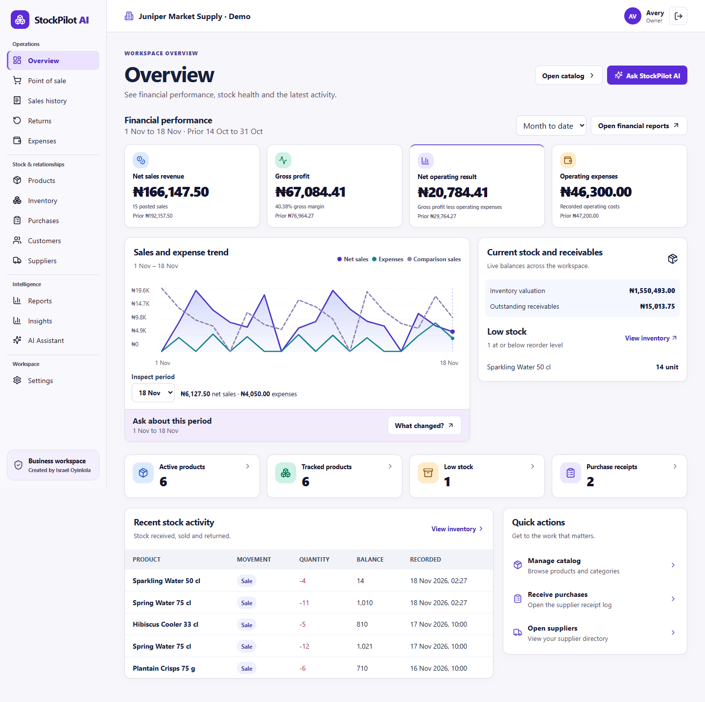
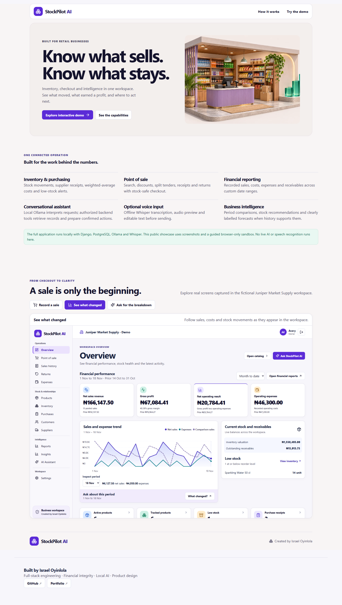
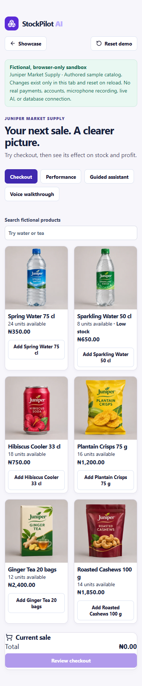
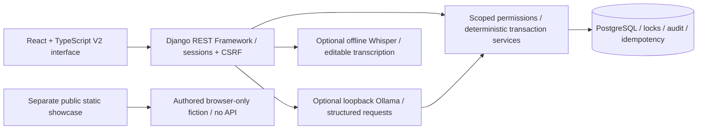

# StockPilot AI

StockPilot AI is a business operations workspace by Israel Oyinlola. It covers accounts, catalog management, stock tracking, purchases, checkout, customer balances, returns, expenses and financial reporting.

[Source code](https://github.com/oyinisrael4/stockpilot-ai) · [Developer GitHub](https://github.com/oyinisrael4) · [Developer portfolio](https://israel-projects-one.vercel.app) · [Public showcase publishing guide](docs/PUBLIC_SHOWCASE.md)



## Full online application — deployment in preparation

**[Open the functioning application](https://stockpilot-ai-p89q.onrender.com)** → Sign in → **Enter fictional demo**.

The verified deployment runs the complete application on **Render Free**, with **Neon Free PostgreSQL** and **Groq Free** chat/speech. The [static showcase](https://stockpilot-ai-p89q.onrender.com/showcase/) remains an additional resource. See the [full-stack deployment guide](docs/FREE_FULLSTACK_DEPLOYMENT.md) for account setup, security, quotas and limitations.

Public-hosted verification on November 22, 2026 passed both end-to-end journeys: real cloud conversations and follow-ups, explicit/duplicate sale confirmation, database persistence, actual cloud transcription, microphone recording and editable transcription, desktop/mobile layout, HTTPS, secure cookies and security headers. [Hosted desktop](docs/screenshots/hosted-overview-1440.png) · [Hosted mobile](docs/screenshots/hosted-overview-390.png).

Visitors share fictional records and a demo identity. Do not enter private information. Free services may sleep or exhaust quotas; email recovery is disabled for this demo. No local computer or offline inference endpoint is exposed.

Groq uses strict structured intents with `openai/gpt-oss-20b` and speech transcription with `whisper-large-v3-turbo`. Financial calculations and confirmations stay in Django. Local Ollama and offline Whisper remain supported. Free services may sleep, throttle or suspend; no paid fallback or automatic upgrade is configured.

## Additional static portfolio showcase — zero backend required

The full working application and the public portfolio have separate builds. The portfolio presents genuine product captures and an explicitly fictional browser sandbox: add products, review/confirm a sale, inspect its stock/profit effects, try a guided transaction proposal and reset. No real payments, database, live AI or microphone processing are available in the static demo. Its sample records never come from a private workspace. Ollama and Whisper remain available in the complete local application.

```powershell
Set-Location frontend
npm.cmd ci
npm.cmd run build:showcase
npm.cmd run preview:showcase
```

Open http://127.0.0.1:5198/ and choose **Explore interactive demo**. Deployable output is **frontend/dist-showcase only**. The static resource is also available at https://stockpilot-ai-p89q.onrender.com/showcase/. See [static hosting instructions](docs/PUBLIC_SHOWCASE.md) for the optional independent build; the primary deployment is the complete Render application. Never upload the workspace folder, root `.env`, `.local`, model weights or backups.





## Architecture and capabilities



The operational app includes workspace roles, products, inventory, suppliers, purchasing, POS, discounts, customers, receivables, returns/refunds, expenses, date-range reports, comparisons and prioritized insights. Financial totals and historical cost snapshots are calculated by backend services. The assistant retrieves scoped business records and prepares proposals; authorized explicit confirmation is required to post. Manual business controls remain available without inference.

The [Phase 7 report](docs/PHASE7_READINESS_REPORT.md) records 60 backend regressions and six browser journeys, security fixes, backup/restore verification and measured local inference limitations. [Phase 8 verification](docs/PHASE8_VERIFICATION.md) covers the static build, demo isolation, accessibility checks and publication audit. These results do not certify a publicly hosted business pilot.

## Testing and reproducibility

Python dependencies are pinned in `backend/requirements.txt`; install frontend packages with the committed npm lockfile. Use Python 3.11+, Node 22.12+ and PostgreSQL 14+. No AI weights or private database are bundled. Follow the setup below for the full application and use `.env.example` for development settings. Production settings and deployment gates are in [the production checklist](docs/PRODUCTION_CHECKLIST.md).

```powershell
# Repository root; local PostgreSQL must be running
.venv/Scripts/python.exe backend/manage.py test core
.venv/Scripts/python.exe backend/manage.py makemigrations --check --dry-run
.venv/Scripts/python.exe backend/manage.py spectacular --validate --fail-on-warn
# frontend/
npm.cmd run build
npm.cmd run build:showcase
npm.cmd run test:showcase
# Full app browser suite requires its isolated stockpilot_browser database:
npm.cmd test
```

Opt-in local-model and voice fixture checks are documented below. Edge is configured for browser tests on Windows; install a compatible Playwright browser and change its channel on other systems.

Known limitations: this is a supervised pilot candidate, with HTTPS/proxy, remote backups, SMTP, monitoring and sustained hosted-load verification still required. CPU local inference can take tens of seconds. The basic forecast requires sufficient history and is an estimate. The public sandbox is intentionally limited and uses an independent illustrative calculation model. No full free hosted AI service, payments gateway or public commercial deployment is claimed.

## Run locally on Windows

Install Python 3.11+, Node.js 22.12+ or 24, and PostgreSQL 14+. Add PostgreSQL's `bin` directory to PATH. In PowerShell from this folder:

```powershell
python -m venv .venv
.\.venv\Scripts\python.exe -m pip install -r backend/requirements.txt
python scripts/local_database.py
.\.venv\Scripts\python.exe backend/manage.py migrate
Set-Location frontend
npm.cmd ci
```

The database script starts a password-protected development cluster on loopback port 55432 and creates a local `.env` with generated secrets. The script refuses to replace an existing `.env`. To use your own PostgreSQL instance, copy `.env.example` to `.env`, fill in the connection settings and generate a Django secret. Keep the environment file out of source control.

Run Django and Vite in separate terminals:

```powershell
# Repository root
.\.venv\Scripts\python.exe backend/manage.py runserver 127.0.0.1:8000

# frontend/
npm.cmd run dev
```

Open [the local app](http://127.0.0.1:5173/register) and create a workspace. The initial workspace starts empty. For local password recovery, Django's console email backend prints the reset link to the server terminal. Configure SMTP for deployed environments.

## Use Phase 2

1. Open **Point of sale**. Search by name, SKU or barcode, add products, and review quantities and discounts. Optional HTTPS product image URLs can be added in **Products**.
2. Review checkout, choose a walk-in or registered customer, and record cash, transfer, or card tender. Credit is the unpaid balance on a registered customer's sale. Payment choices record tender received outside the app.
3. Use **Sales history** to resume drafts, print receipts, collect outstanding payments, or review a return or void. Managers and owners can reverse sales. A return reduces the receivable before recording any refund.
4. Record operating costs in **Expenses**. Corrections require a reason and retain the before and after values in **Audit**.
5. Open **Overview** for month-to-date performance or **Reports** to select a date range, compare periods, export CSV, or use your browser's print dialog to save a PDF.

## Use the typed assistant

Open **AI Assistant** or use **Ask StockPilot AI** on the dashboard. Conversations belong to the signed-in account and selected workspace. Try these commands with records in your own catalog:

- “How much profit did I make this month?”
- “What were my sales between November 1 and November 8?”
- “How much did I spend on transportation last month?”
- “Which products are running low?” or “Which customers owe me money?”
- “Sell 2 WATER-75 in cash.” The assistant previews the sale at the catalog price. Edit or cancel the preview, or choose **Confirm sale** to record it. Compare the returned sale ID and on-hand balance with **Sales history** and **Inventory**.
- “Record 3000 naira as transport expense in cash.” The expense category must already exist.
- “Add a purchase of 20 units of bottled water from North Wholesale at 180 each.” The supplier and product must already exist.

Previews expire after 15 minutes and can be edited while pending. In the same conversation, “make it 5 instead” revises the pending quantity and “cancel” discards it. A typed “yes” points you back to the preview’s **Confirm** button. Confirmation rechecks current authorization, stock and pricing. A repeated confirmation returns the original result. Text commands currently support one product and one tender per sale. Use the manual POS for multiple lines and split payments. The application records tenders received outside the app.

“I have stocked up 100 units of water-75” asks you to choose a purchase receipt, opening stock, or an incoming stock adjustment. Receipts need a supplier and unit cost. Opening stock uses the first-movement rule and needs a unit cost. An adjustment increases previously costed inventory at its existing weighted-average cost, requires a reason, and records an audit event. These operations require an owner or manager and an explicit confirmation.

### Optional model provider

With no provider configured, the page displays **Limited demonstration mode**. It supports the documented command patterns and reads the same workspace records as the reporting and inventory pages.

To use OpenAI, set `STOCKPILOT_AI_PROVIDER=openai`, `STOCKPILOT_AI_API_KEY` and `STOCKPILOT_AI_MODEL` in the backend environment or the ignored root `.env`, then restart Django. Choose a model that supports strict Chat Completions function calling. `STOCKPILOT_AI_ENDPOINT` defaults to `https://api.openai.com/v1/chat/completions`. An alternate endpoint must use HTTPS and support the same function-calling contract. The provider can select a read operation or request a preview. Django handles every database query and confirmation. See the [official OpenAI function-calling documentation](https://developers.openai.com/api/docs/guides/function-calling).

To verify a live connection after setup, try “I want to sell 2 water of 75cl.” and look for **Model-assisted intent**. Use a matching product or replace the product description with one in your catalog. For an isolated end-to-end check from PowerShell, set `$env:STOCKPILOT_RUN_LIVE_AI_TESTS = "1"` and run `.\.venv\Scripts\python.exe backend/manage.py test core.test_assistant.AssistantTests.test_live_configured_provider_exact_sale_and_followup`. It uses the Django test database and makes four provider requests, which are billable in hosted mode. Remove the opt-in environment variable afterward. The regular suite uses controlled provider responses.

With a provider configured, business messages go to the model first. Explicit preview controls such as cancel and quantity edits are handled on the server. Each model request includes the current message, up to four earlier user messages capped at 500 characters each, the active draft or report topic, workspace currency, and local date. Financial results, catalog pricing, stock balances, and authorization stay on the server. Hosted requests use an eight-second socket timeout and an 800 completion-token limit. Prompts are limited to 2,000 characters. Review the provider’s rates and data terms before enabling it. Keep credentials and sensitive personal information out of chat. If a configured provider fails, the assistant reports the error and waits for a retry.

### Local Ollama model on Windows

Install [Ollama for Windows](https://docs.ollama.com/windows). If the tray application started its own server, quit it first. Run the following from the project root in a dedicated terminal. For a portable install, pass `-OllamaPath` with the path to its executable.

```powershell
.\scripts\run_local_model.ps1
```

The script binds Ollama to loopback, disables its cloud features, and stores models under the ignored `.local/ollama-models` directory. Use `ollama list` to find the exact model name. If the cache is empty, download a text model with `ollama pull qwen3:4b`, or import the [official Qwen3 4B GGUF](https://huggingface.co/Qwen/Qwen3-4B-GGUF) into Ollama. The portable executable can run the same commands.

Set the following in the project's existing `.env`, then restart Django and refresh the assistant.

```dotenv
STOCKPILOT_AI_PROVIDER=ollama
STOCKPILOT_AI_MODEL=stockpilot-qwen3:4b
STOCKPILOT_OLLAMA_ENDPOINT=http://127.0.0.1:11434/api/chat
```

Use `stockpilot-qwen3:4b` for the imported StockPilot model or the exact name shown by `ollama list` for a different download. Ollama mode requires no key. Django accepts only a numeric loopback endpoint for this mode and validates the model's structured response before calling the same business tools used in hosted mode. The **Local model configured · Ollama** header confirms the configuration. **Model-assisted intent** on a reply confirms the model responded successfully. Run the same opt-in test above to verify the local provider and PostgreSQL together. Initial inference can take longer while the model loads. Keep the Ollama terminal open while using the assistant.

### Voice input

Install the Python requirements and download the [Whisper Tiny English weights](https://huggingface.co/Systran/faster-whisper-tiny.en) once from the project root, then restart Django.

```powershell
.\.venv\Scripts\python.exe -m pip install -r backend/requirements.txt
.\.venv\Scripts\python.exe scripts/setup_local_voice.py
```

In **AI Assistant**, select the microphone, allow browser access, and select **Start recording**. Stop to play back or discard the recording. Select **Transcribe**, edit the result, then choose **Use transcript** to add it to the composer. Sending it uses the same chat history and transaction previews as typing. Any sale or expense still requires explicit confirmation.

Recording requires a microphone and a compatible browser on localhost or HTTPS. Each English clip is limited to 45 seconds. StockPilot runs [faster-whisper](https://github.com/SYSTRAN/faster-whisper) with CPU int8 and two inference threads. Audio stays in the tab until **Transcribe** and is held in memory on the StockPilot server during processing. In local development that server is your own computer. The model loads from the ignored local folder and needs no network access or API key at runtime. If voice is unavailable, close the dialog to keep typing.

For live verification, set `STOCKPILOT_VOICE_WAV` to an absolute path to a 16 kHz mono 16-bit WAV saying “I want to sell two bottles of water” and run both test suites below. Chromium uses the fixture as its virtual microphone while Django runs real inference. The test reviews and edits the transcript before sending it.

## Business Insights

Open **Insights** from the workspace navigation. Start with **Priorities**, then open **Performance**, **Stock**, or **Payments** for supporting figures. Change the dates and choose a preceding equal period or a custom comparison. The dashboard labels incomplete or unequal comparisons. Use **Discuss this comparison** to bring the exact dates into the assistant composer.

Try “Which items contributed most to our gross profit this month?”, then type or dictate “What about last month?” in the same conversation. Other examples include “Explain the change,” “Show unusual expense activity,” “How many units should I reorder?” and “Forecast net sales.” The local conversational model interprets the question. Backend services calculate figures and assemble explanations using recorded transactions.

Reorder quantities and forecasts are estimates. The forecast uses eight complete weeks and reports the historical low and high as context. Stock and receivables show current balances. Invoice age is measured from posting, and recorded collections use the selected dates. [The implementation roadmap](docs/IMPLEMENTATION_PLAN.md) records each signal's thresholds and assumptions.

To verify the live spoken insights follow-up, opt into `STOCKPILOT_RUN_LIVE_AI_TESTS=1` with Ollama running and point `STOCKPILOT_INSIGHTS_VOICE_WAV` to a mono 16 kHz PCM WAV saying “What about last month?” The integration test uses local Whisper, then submits the resulting text in the same conversation as a typed insights question.

See the verified [desktop priorities](docs/screenshots/phase5-insights-priorities.png) and [mobile comparison](docs/screenshots/phase5-insights-mobile.png) from the isolated Edge fixtures.

## Portfolio demo

The public home page opens at the frontend root when signed out. Use `/about` to view it while signed in.

**Juniper Market Supply · Demo** uses its own PostgreSQL database. The seed command uses the same stock, checkout, payment, return and expense services as the application. It requires local debug mode and an empty `stockpilot_demo` database. It never seeds the regular workspace.

From the project root, with PostgreSQL on PATH:

```powershell
.\.venv\Scripts\python.exe scripts/local_database.py --demo
$env:PGDATABASE = "stockpilot_demo"
.\.venv\Scripts\python.exe backend/manage.py migrate
.\.venv\Scripts\python.exe backend/manage.py seed_portfolio_demo
$env:DJANGO_TRUSTED_ORIGINS = "http://127.0.0.1:5196"
$env:STOCKPILOT_PUBLIC_URL = "http://127.0.0.1:5196"
.\.venv\Scripts\python.exe backend/manage.py runserver 127.0.0.1:8092 --noreload
```

Choose a password when prompted and sign in as `demo-owner`. To change the demo password later, set `PGDATABASE=stockpilot_demo` and run `backend/manage.py changepassword demo-owner` with the virtual environment's Python. Keep the demo server separate from your usual backend.

In a second PowerShell terminal:

```powershell
Set-Location frontend
$env:STOCKPILOT_API_ORIGIN = "http://127.0.0.1:8092"
$env:VITE_STOCKPILOT_CSRF_COOKIE = "stockpilot_demo_csrftoken"
npm.cmd run dev -- --host 127.0.0.1 --port 5196 --strictPort
```

Open [the local demo](http://127.0.0.1:5196/). The dataset includes ten weeks of fictional sales, stocked products, purchase receipts, customer payments and open balances, returns, and operating expenses.

See the [public landing page](docs/screenshots/phase6-landing-desktop.png), [desktop demo](docs/screenshots/phase6-overview-desktop.png), [mobile overview](docs/screenshots/phase6-overview-mobile.png), [POS](docs/screenshots/phase6-pos-desktop.png) and a [live assistant answer](docs/screenshots/phase6-assistant-desktop.png).

## V2 visual refinement

Overview offers equal-length preceding comparisons and contextual questions that carry the selected dates into chat. History and prompts can be collapsed to give conversations more room. Wide tables retain their columns in keyboard-scrollable regions. All motion respects reduced-motion settings.

The public page contains an original retail illustration and selectable previews captured from the demo workspace. **Explore live demo** opens the separate local demo login. Configure `VITE_STOCKPILOT_DEMO_URL` when deploying to a dedicated demo host. The six catalog photographs use URLs on the demo product records.

See [desktop overview](docs/screenshots/phase61-overview-1440.png), [mobile overview](docs/screenshots/phase61-overview-390.png), [POS](docs/screenshots/phase61-pos-1440.png), and [landing](docs/screenshots/phase61-landing-desktop.png). Generated assets, source prompts and attribution are recorded in [the artwork notes](docs/PHASE61_ARTWORK.md).

## Verify

```powershell
# Repository root
.\.venv\Scripts\python.exe backend/manage.py test core
.\.venv\Scripts\python.exe backend/manage.py spectacular --validate --fail-on-warn --file .local/openapi.yaml
python scripts/local_database.py --browser-tests
$env:PGDATABASE = "stockpilot_browser"
.\.venv\Scripts\python.exe backend/manage.py migrate --noinput
Remove-Item Env:PGDATABASE

Set-Location frontend
npm.cmd run build
npx.cmd playwright install chromium
npm.cmd test
```

To use installed Microsoft Edge, set `STOCKPILOT_BROWSER=msedge` before running Playwright. The browser test starts its own servers on ports 5174 and 8001 and writes fictional fixtures to the separate `stockpilot_browser` database. Set `STOCKPILOT_TEST_FRONTEND_PORT` and `STOCKPILOT_TEST_BACKEND_PORT` if either port is in use. Desktop and mobile captures are saved under `frontend/test-results`. The API suite creates and drops its own test database.

The verified Phase 1 run passed nine Django tests on PostgreSQL and one Playwright journey in Edge. TypeScript, the Vite production build, migration drift detection and strict OpenAPI validation passed. The [desktop inventory](docs/screenshots/inventory-desktop.png) and [mobile overview](docs/screenshots/overview-mobile.png) captures show the browser fixture after a successful receipt.

Phase 2 adds PostgreSQL checks for checkout, discounts and tax, snapshot cost, concurrent oversell prevention, idempotency, receivables, returns and voids, expense audit history, period accuracy and isolation. The browser journey also exercises split tender, collection, CSV download, a partial return, and the revised stock and operating result. See the [point of sale](docs/screenshots/phase2-pos.png), [dashboard](docs/screenshots/phase2-dashboard.png), and [reports](docs/screenshots/phase2-reports.png) captured from that isolated fixture.

Phase 3 adds backend tests for report accuracy, product ambiguity, proposals and clarification, expiry, overselling, retries, tenant isolation, authorization and simulated provider errors. The browser journey checks exact report totals, edits and confirms a sale, reloads the saved conversation, cancels an expense and verifies mobile navigation. See [Assistant](docs/screenshots/phase3-assistant.png), [sale preview](docs/screenshots/phase3-sale-preview.png) and [recorded sale](docs/screenshots/phase3-sale-confirmed.png).

Phase 4 passed real offline transcription in Django and Edge using a spoken WAV fixture. The Edge journey verified preview, discard, transcript editing, explicit send and sale confirmation. See the [desktop transcript review](docs/screenshots/phase4-voice-transcript.png) and [mobile permissions fallback](docs/screenshots/phase4-voice-fallback.png).

## Architecture and scope

The React frontend talks to Django REST Framework through same-origin routes. Django sessions and CSRF protect account and write actions. Membership resolves access per business. PostgreSQL transactions and row locks protect stock updates, and purchase receipt IDs prevent a retry from adding stock twice. Average inventory cost uses four decimal places. The catalog uses fixed units with no conversions. The phase and role details are in [the implementation plan](docs/IMPLEMENTATION_PLAN.md).

Checkout applies item discounts before allocating invoice discounts and taxing the resulting line amounts. Currency amounts round to cents using half-up rounding. Returns allocate the original net amount and tax cumulatively, preserving totals across repeated partial returns. Posted sales keep their original cost snapshot. Period reports use inclusive business-local calendar dates and recognize returns on the reversal date. Inventory value and receivables show current balances.

For deployment, serve the Vite build and proxy `/api/` to a production WSGI server on one HTTPS origin. Set `DJANGO_DEBUG=0`, the exact public origin and allowed hosts, a strong secret, SMTP configuration, and managed PostgreSQL credentials with TLS. Enable Django's proxy trust setting only if the reverse proxy overwrites `X-Forwarded-Proto`. Configure a shared cache for account throttling before running multiple workers. The local database bootstrap and Django development server are for development.

Remaining scope includes manual inventory adjustments and write-offs, catalog import/export, and production deployment. Hosted provider testing requires valid credentials. Successful speech capture requires a microphone and a supported browser speech service. Assistant conversations currently persist in PostgreSQL without automatic expiration. Integrated payment processing and managed image uploads are outside the current tender-recording and image-URL workflows.

## Security and production readiness

Phase 7 adds shared inference admission, bounded request handling, shared production throttling, hardened production configuration, safer reset/error handling and a measured catalog index. DRF is pinned to the advisory-fixed 3.18.2 release. The existing V2 UI, confirmation flows and local AI remain in use.

Read the [security, reliability and performance report](docs/PHASE7_READINESS_REPORT.md), [backup/restore procedure](docs/DATABASE_RECOVERY.md) and [production deployment checklist](docs/PRODUCTION_CHECKLIST.md) before public hosting or a business pilot. A hosted backend cannot automatically reach the Windows laptop's Ollama runtime.

Install optional production WSGI support with `pip install -r backend/requirements-production.txt`. With a private production environment configured, run `backend/manage.py migrate`, `backend/manage.py createcachetable`, and `backend/manage.py check --deploy` using the virtual environment Python, then start `scripts/serve_production.py` behind the reviewed HTTPS proxy. The example proxy configuration is in `deploy/nginx.conf.example`.

Security checks can be repeated with `scripts/check_secret_leaks.py`, pip-audit and npm audit. `scripts/database_recovery.py` creates a new backup or restores only into a new isolated database. `benchmark_workspace` refuses any database except `stockpilot_perf`; it creates a fictional 10,000-product/3,000-sale fixture there. `scripts/benchmark_ai.py` measures the installed local provider and a spoken WAV without posting business records. Performance measurements and operating limitations are recorded in the Phase 7 report.
