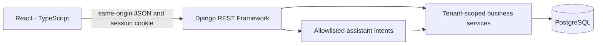
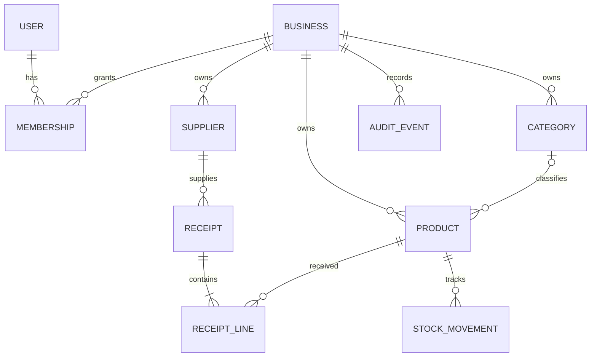

# StockPilot AI implementation plan

The phase list comes from the starter master prompt. The starter kit contains no separate implementation plan. Israel Oyinlola is the project creator.

Vite proxies API calls locally. Production serves the frontend and API on one HTTPS origin. Session cookies are HttpOnly. Django verifies CSRF on all mutations, including registration and login. The active business is explicit in each tenant URL and resolved through the signed-in user's membership. Decimal amounts use NGN by default. Store timestamps in UTC and derive reporting boundaries in the business timezone.

| Role | Phase 1 permissions |
| --- | --- |
| Owner | Settings, membership, catalog, suppliers, opening balances, receipts |
| Manager | Catalog, suppliers, opening balances, receipts |
| Cashier, Analyst, Viewer | Read operational data |

Phase 1 routes cover account registration, login, logout, profile, reset, workspace overview, products, inventory, suppliers, purchases, and settings. The API uses `/api/v1/` with `auth/`, `businesses/` and resources under `businesses/{id}/`. Use POST for stock opening and receiving. Lock product rows in ascending ID order before changing stock. One opening movement per product and one receipt per business and idempotency key. Weighted-average cost is kept to four decimal places. Posted receipts and movements remain traceable. Products can be archived.

The navy sidebar, light lavender canvas, violet actions, cyan highlights, status colors and panel styling follow DESIGN_SYSTEM.md. Use narrow-screen navigation and accessible labels, with horizontal scrolling only for data tables.

| Phase | Work and gate |
| --- | --- |
| 0 | Architecture and schema plan, dev setup, API and build skeleton. Verify runtime and database. |
| 1 | Accounts, roles, workspace settings, products/categories, inventory opening, supplier management, purchase receiving. Run PostgreSQL integration tests, frontend type/build, browser flow. |
| 2 | Customers, POS, discounts, payments, returns, expenses, dashboard, reporting. Extend the schema with Sale, SaleLine, SalePayment, SaleReturn, ReturnLine, Expense and expense categories. Verify exact decimal accounting, concurrency and period boundaries. |
| 3 | Typed assistant with tenant-scoped conversation, message and proposal records. Parse to allowlisted intents, query deterministic reports, and create expiring proposals. Revalidate and post only on explicit confirmation. Test ambiguous input, scoping, replay and unauthorized mutations. |
| 4 | Voice transcript review and shared typed flow. Verify edit, cancellation, denied permission and unsupported browser. Refine responsive layout and keyboard interactions. |
| 5 | Business insights, change drivers, stock and collections signals, and an explicitly labeled forecast. Verify deterministic calculations, local model conversations, and desktop and mobile acceptance. |
| 6 | Shared visual system, responsive workspace refinements, public landing and isolated portfolio demo. Verify keyboard behavior, reduced motion, existing regressions and final captures. |

Each phase must pass its verification gate before work advances to the next phase.

## Phase 2 implementation

- Owners and managers can sell, record payments, manage expenses and reverse sales. Cashiers can manage customers, save and post sales, and record payments. Analysts and viewers have read access.
- Business-scoped endpoints add `customers/`, `sales/`, `returns/`, `expense-categories/`, `expenses/`, `reports/`, and `reports/csv/`. Sale actions cover quoting, drafting, checkout, collecting payments, and reviewing and posting returns or voids.
- A sale retains immutable priced lines and cost snapshots. Returns retain original line references, separately record a tender refund and restock choice, and update the remaining receivable. Sales, payments, and reversals have tenant-specific retry keys.
- Inventory movements include deductions and traceable restocks. Return reporting reverses cost only for restocked quantities. Reports use local calendar boundaries, recognize reversals on the date recorded, and show live inventory and receivables separately from period activity.
- The browser test uses a separate database to post a discounted sale, collect a split tender and remaining balance, record an expense, check exact figures, download the report, and confirm a partial return.

## Phase 3 implementation

- The text assistant stores private conversation exchanges and proposal records per workspace and account. Backend tools reuse the same report, checkout, receipt and expense services as the manual workflows.
- A local command parser handles documented phrases. An optional server-side provider extracts a validated, allowlisted intent for other phrasing. Django resolves workspace records and generates the response cards from query results.
- Proposal creation is separate from posting. Editing increments the revision and refreshes expiry. Confirmation revalidates the role and preview under locks, records once, and returns the committed transaction reference. Cancellation and expiry never post a transaction.
- The responsive assistant supports searchable history, suggested prompts, clarification, transaction review, and report links.

## Phase 4 implementation

- Record English speech for up to 45 seconds, play the clip back, discard it, or transcribe it with the local Whisper Tiny English model. The dialog handles denied permissions, missing audio devices, unsupported browsers and inference failures.
- The authenticated, workspace scoped transcription endpoint caps audio size and duration, limits inference concurrency, and keeps audio out of chat history and business records.
- Users edit transcripts before moving them into the existing chat composer. Explicit send and transaction confirmation follow the same paths as typed messages. Manual workspace controls remain available independently.
- Verification covers invalid audio, authentication, tenant isolation, no writes during transcription, and an opt-in browser journey from virtual microphone to real local transcription, transcript edit and explicit sale confirmation.
- Verified on Windows with PostgreSQL and Edge. The speech model processed an audio fixture supplied through the virtual microphone. See [transcript review](screenshots/phase4-voice-transcript.png) and [permission fallback](screenshots/phase4-voice-fallback.png).

## Phase 5 implementation

- **Insights** and the assistant share a workspace scoped, read-only insights service. It accepts a selected date range, an optional custom comparison, and daily, weekly or monthly reporting intervals. Dates use the workspace time zone. The default comparison is the immediately preceding, equal-length period.
- Financial totals use the reporting ledger. Product performance uses posted line amounts, immutable costs, and reversals on the recorded return date. Operating result drivers reconcile the change to gross sales, discounts, returns, cost of goods, and expenses.
- Risk signals use explicit thresholds and link to manual workflows. Positive expense category baselines can flag growth of at least 50% across comparable periods. A selected entry can also flag at three times the average of at least three comparison entries. These signals call for review.
- Reorder estimates use 28 complete days and require at least four days with a recorded sale for the product. They target 14 days of net demand or the configured reorder level, whichever is higher. Slow-moving candidates require listed products with stock on hand, at least seven recent positive net sales days across the workspace, and at most one selling day for the product. Historic availability and supplier lead times are assumptions to verify manually.
- Current receivables use open completed sales after returns and payments. Collections and follow-on payments reflect the selected dates. Invoice age measures time since a sale was posted. The application has no due-date or credit-risk model.
- The weekly net sales estimate uses the median of eight complete weeks, with at least six positive weeks and no negative weeks. The observed minimum and maximum describe past variability. The estimate is a baseline for the current calendar week.
- Ollama selects a bounded report topic and handles natural follow-ups. The backend assembles explanations and renders all figures. Edited voice transcripts enter the same context as typed messages. Insights requests have no transaction write path.
- Verified the Insights acceptance journey in Edge and a typed-to-spoken report follow-up using the running Ollama and Whisper models. See the [desktop recommendations](screenshots/phase5-insights-priorities.png) and [mobile comparison](screenshots/phase5-insights-mobile.png).

## Phase 6 implementation

- The public landing page presents stock, checkout, financial analysis and typed or spoken assistant workflows. A CSS parcel illustration provides a visual identity with no external asset dependency. The signed-in root remains the operational overview.
- All workspace routes inherit updated surfaces, type, controls, tables and interactive states. Overview pairs financial metrics and a chart with inventory and a contextual assistant link. POS keeps scan-to-add and returns focus to search after the receipt closes. Chat, recording, transcription and proposals expose progress and explicit next steps.
- The fictional Juniper Market Supply workspace seeds a separate development database through the same stock, checkout, return, payment and expense services. Seeding refuses regular workspace databases or a populated demo database. Demo cookie names keep browser sessions independent across local ports.
- Acceptance covers public navigation, focus return, reduced motion, responsive route layout and transactional regressions.
- Captures show fictional ledger data in the [desktop overview](screenshots/phase6-overview-desktop.png), [mobile overview](screenshots/phase6-overview-mobile.png), [POS](screenshots/phase6-pos-desktop.png), and [mobile voice dialog](screenshots/phase6-assistant-voice-mobile.png).

## Phase 6.1 visual refinement

The supplied StockPilot V2 attachments supersede the original visual references. The light lavender navigation groups operations, stock and relationships, intelligence, and settings. All values shown by workspace components use existing scoped endpoints.

- Overview now offers month-to-date, seven-day and thirty-day windows with equal-length preceding comparisons. The chart shows both periods and provides a date-aware assistant question. Financial cards keep each number on one line. Wide data tables retain columns and are keyboard-scrollable.
- Chat offers collapsible history and prompts, plain-language status feedback, and connection diagnostics on demand. Voice review and explicit transaction confirmations use the existing workflows.
- Locally stored generated artwork replaces the cube illustration and supplies six fictional catalog photographs. Product image URLs are stored on the isolated demo records. The landing preview uses actual demo screen captures with selectable checkout, overview and assistant steps.
- The live-demo link opens the dedicated demo login on localhost. Deployed builds can configure VITE_STOCKPILOT_DEMO_URL to the isolated demo host. Demo authentication and its separate database remain in use.
- Forecasts include the recorded weekly history and a dashed estimate segment. Accounting calculations and forecast thresholds are unchanged.
- Verification passed all 50 backend tests with local AI and speech enabled, all six browser journeys, and a final targeted Insights journey. Desktop and mobile screenshots were reviewed. Layout checks covered 320, 390, 768, 1024, 1280 and 1440 pixels; the final currency pass checks for both wrapping and clipping.

## Phase 7 verification and readiness

- Upgraded DRF to 3.18.2 following known advisory findings. Added JSON charset/header/body/query limits, private API cache policy, shared inference admission and production database-backed throttling. Production startup checks hosts, secret strength, HTTPS origins, email backend and demo isolation.
- Authentication, role/workspace isolation, prompt injection, canceled/repeated confirmations, concurrent stock depletion, concurrent duplicate receipts, costing, reversals and reporting are covered by the backend regressions. The V2 frontend remains in use.
- An isolated 10,000-product/3,000-sale benchmark exposed catalog sorting; a composite index replaced the full-scan/sort plan with an index scan. Local Qwen, Whisper and built-frontend timings are documented.
- A snapshot-consistent backup restored into a new database and matched all business-table row hashes. The restore script rejects ordinary or existing database targets.
- Waitress startup and production-shaped Django checks were exercised only on loopback. Real HTTPS/nginx, remote backup, SMTP, alerting and sustained hosted load remain deployment gates.
- See PHASE7_READINESS_REPORT.md, DATABASE_RECOVERY.md and PRODUCTION_CHECKLIST.md for evidence and remaining work. This phase does not authorize deployment or charges.

## Phase 8: public portfolio and deployment preparation

### Revised primary deployment

The owner replaced the static-only launch with a complete Render Free/Django/React, Neon Free PostgreSQL, Groq Free chat/speech deployment. The static build remains additional. Cloud providers preserve local Ollama/Whisper, structured backend intent validation, confirmation and accounting services. See FREE_FULLSTACK_DEPLOYMENT.md for current verification and account prerequisites. Hosted URL and public-host checks remain pending until actual deployment.

- Added an independent static entry/build, relative assets and hash navigation. The complete operational application retains its existing entry point and backend services.
- The public Juniper sandbox uses an authored fictional catalog and tab-local state. Checkout, stock boundaries, confirmation, cancellation, report summaries and reset are interactive. Guided assistant scenarios explicitly disclose that no model is connected. Voice is an illustrated explanation rather than simulated recognition.
- Product capabilities and genuine isolated-demo captures appear on the landing page. Verified developer GitHub and repository-advertised portfolio links are included. No private workspace export or credentials are required for the public artifact.
- Publication audit checks git-visible files, every reachable historical blob, known local secret values, credential patterns, excluded model/database artifacts and the static output. There was no Git history or remote at the start of this phase.
- Added a zero-cost hosting comparison, static security headers, an inactive manual Pages workflow template, reproducible build/publishing instructions and final screenshots. No deployment, repository publication, tunnel or charge is authorized.
- Verification and remaining external launch gates are recorded in PHASE8_VERIFICATION.md and PUBLIC_SHOWCASE.md.
